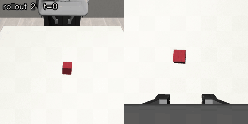
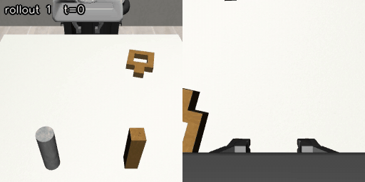

# Imitate and Dream

**Uncertainty-aware ranking for world-model-guided generative robot policies.**

A flow-matching policy trained on demonstrations proposes several candidate action chunks.
A cheap latent world model imagines each one and scores it, and its own uncertainty decides
how much to trust that score. Candidates are ranked over an ensemble of
latent dynamics models. The policy itself is never retrained.

Experiments use robosuite (Franka Panda) with robomimic image demonstrations on **Lift** and
**Square** (nut assembly).

## Architecture


| Component | What it is | Status |
|---|---|---|
| **Flow-matching policy** | A small ViT per camera plus a proprio MLP condition an action transformer that predicts a chunk of 16 actions with flow matching. | Trained on Lift and Square |
| **Encoder** | Frozen DINOv2 patch tokens from both cameras plus a proprio token are fused by a transformer into one 256-D latent `z`. It is trained with an auxiliary privileged-state head and a progress head, on demonstrations and random-action data. | Trained on Square |
| **Progress head** | `g(z) ∈ [0, 1]`: task progress (`t / T` on demonstrations, 0 on random-action data). It scores imagined states. | Trained with the encoder |
| **Latent dynamics ensemble** | M residual MLPs that roll `z` forward under a candidate action chunk. Their disagreement is the uncertainty `σ`. | In progress |
| **Ranking** | Sample K chunks, imagine each with every ensemble member, score with `μ − λσ`, and fall back to the default sample when `σ` exceeds a threshold. | Planned |

## Results so far

Rollouts of the trained flow-matching policy (agent view | wrist view).

| Lift | Square (nut assembly) |
|---|---|
| [](assets/lift.gif) | [](assets/square_nut_assembly.gif) |

## Documentation

- [Local setup](docs/local-setup.md): virtual environment, rendering, and preparing the demonstration datasets
- [Train the flow-matching policy](docs/train-flow-policy.md): training, metrics, and evaluating in simulation
- [Train the world-model encoder](docs/train-wm-encoder.md): data, losses, and which metrics to watch
- [Random-action data collection](docs/random-data-collection.md): collector usage and the HDF5 layout
- [Random-data validation](docs/random-data-validation.md): simulator checks for the collected data
- [Datasets](datasets/README.md): where the datasets come from and how they are prepared

## Repository layout

```
models/
  imitation_policy/   flow-matching policy (ViT encoders, action transformer)
  world_model/        latent encoder, fusion transformer, aux and progress heads
  common/             shared parts (frozen DINOv2 tokenizer, random-shift augmentation)
scripts/
  datasets/           dataset classes and the random-action collector
  imitation_policy/   policy training, rollouts, pass@K oracle
  world_model/        encoder training
docs/                 setup and training guides
nautilus/             cluster job for policy training
```
